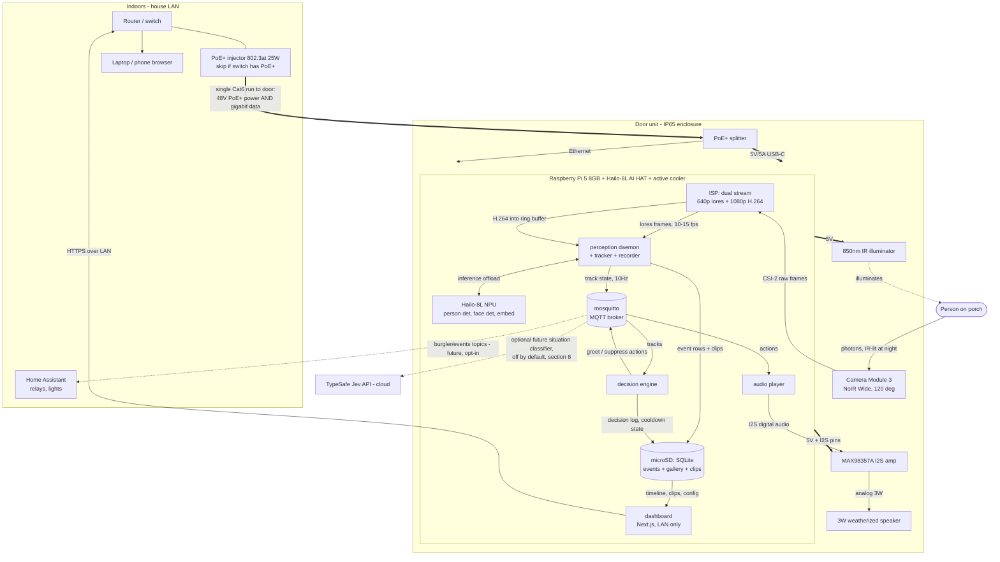
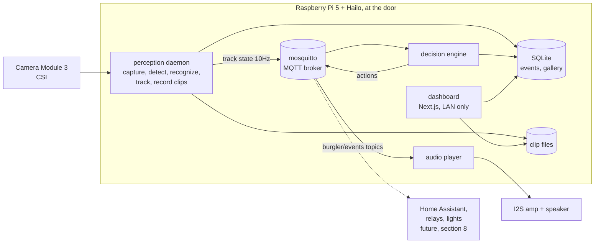

# Burgler - System Architecture

A doorbell camera that detects people approaching the door, recognizes a small enrolled set of friends entirely on-device, and plays a per-person audio line. Companion doc: [HARDWARE.md](./HARDWARE.md).

Design principles, in priority order: the core loop is local and keeps working with the internet down; identity decisions are debounced and conservative (silence beats misfires); every action is an event on a bus so hardware extensions bolt on without core changes.

## 1. Research summary: Jev by TypeSafe, and why it is not in the core design

What Jev actually is, from TypeSafe's own material and independent coverage:

- A hosted "System One" decision model: you POST structured JSON state to `api.typesafe.ai/v1/systemone` and get back typed answers with calibrated probabilities in 70-500ms. Three question types: `Choice` (pick one of up to 255 options), `Score` (position on 2-10 ordered levels), `Noul` (yes/no as a probability). Input is text/JSON only. It generates no text and accepts no images. ([TypeSafe launch post](https://typesafe.ai/blog/introducing-system-one-models-and-jev))
- API-only, waitlisted early access, Python 3.10+ / Node 20+ SDKs, $0.042 per million input tokens with output free. There is no local, on-prem, or edge deployment. ([practical guide](https://dev.to/valyuai/how-to-use-jev-a-practical-guide-to-typesafes-system-one-model-g5e), [Tom's Hardware coverage](https://www.tomshardware.com/tech-industry/artificial-intelligence/typesafe-ais-jev-offers-an-alternative-to-llms-that-claims-to-be-193x-faster-and-445x-cheaper-system-one-type-model-is-bespoke-for-probabilistic-decision-making))
- Its own ecosystem's real-time projects layer it deliberately: control loops and safety in ordinary code, classical CV at frame rate, Jev consulted at ~1-2.5Hz for advisory judgment only. As one project README puts it, Jev "cannot be the perception layer, and it cannot run at control rate."

Consequences for Burgler:

1. **Detection and recognition cannot use Jev** - it takes no images. They must be local CV, which the privacy constraint required anyway.
2. **The remaining candidate role was the decision layer** (greet vs stay silent). But examined honestly, every decision this system makes - debounce, per-person cooldowns, quiet hours, multi-person priority - is deterministic logic with well-defined inputs. A small state machine expresses it exactly, runs in microseconds, works offline, and is unit-testable. Routing it through a waitlisted cloud API would add 70-500ms, an API key, and an internet failure mode, in exchange for calibrated probabilities on questions that have no probabilistic content.

**Verdict: Jev is out of the core design.** Not because the research came back negative on the product, but because this system contains no judgment call of the shape Jev is built for - yet. Where one could appear is fuzzy situation classification ("delivery driver vs stranger lingering vs passerby") over structured track features; that is a genuine `Choice`/`Noul` question at ~1Hz, and section 8 reserves a strictly optional, off-by-default slot for it. The decision-engine interface is kept narrow so that experiment slots in without touching anything else.

## 2. Hardware summary and full-system diagram

Raspberry Pi 5 (8GB) + Hailo-8L NPU (13 TOPS), Pi Camera Module 3 NoIR Wide + 850nm IR illuminator, MAX98357A I2S amp + 3W speaker, IP65 enclosure at the door, PoE+ as the primary power/network plan. Full reasoning, alternatives, and BOM (~$290-310 depending on PoE gear) in [HARDWARE.md](./HARDWARE.md).

The diagram below is the whole system on one page: every hardware component, the power path (thick edges), the network path, and the data flow from photons to speaker. Dashed edges are optional/future. Section 3 zooms into the software boxes.



Reading it as the happy path: person steps onto the porch -> camera -> ISP splits into an inference stream and a recording stream -> perception runs the three NPU models and tracks identity evidence -> decision engine confirms "alex" and emits a greet action -> audio player pushes the roast out the speaker, roughly 1-1.5s after the face resolves. Meanwhile the clip and event row land on the SD card, and the dashboard can replay it from any browser on the LAN. Power for everything at the door arrives over the one Ethernet cable; nothing in the core loop leaves the enclosure.

Variant B (WiFi + mains, if the Ethernet pull turns out infeasible): delete `INJ` and `SPL`, power `PI5` from an outdoor 27W USB-C supply, and the `DASH -> RTR` / `MOSQ -> HA` edges ride the Pi's WiFi instead. Everything else is unchanged.

## 3. Software architecture

Language: **Python** for all on-device services. Coming from C/C++ this deserves justification: the hot path (three neural nets) executes on the Hailo NPU, and the camera pipeline runs in the ISP/encoder hardware. The Python processes are glue moving buffers and dicts at 10-15Hz, which is nothing. Meanwhile Picamera2, HailoRT bindings, and the Hailo example pipelines are Python-first; fighting that with C++ buys latency nobody can perceive at the cost of every integration being the hard version. HailoRT has a C++ API if profiling ever proves a real bottleneck. The dashboard is TypeScript/Next.js, matching your web experience.

Processes (each a systemd unit, each a small codebase):



### perception daemon

Owns the camera (single-owner resource, so clip recording lives here too). Picamera2 emits two streams from one sensor: a low-res stream (~640px) for inference and a 1080p H.264 stream into an in-memory circular buffer for clips.

Per-frame pipeline, all inference on the Hailo NPU using precompiled model-zoo binaries:

1. **Person detection** (YOLOv8n): cheap "someone is here" signal while a face is still too small/far to resolve. Starts tracks early and triggers clip pre-roll.
2. **Face detection + 5-point landmarks** (SCRFD) on the frame, associated to person boxes.
3. **Alignment + embedding** (ArcFace-class, 112x112 input, 512-d output) on each detected face.
4. **Matching**: cosine similarity against the enrolled gallery (section 6). Produces `(track_id, best_name, similarity)` per face.
5. **Tracking**: IoU/centroid tracker so a person keeps one `track_id` across frames. Identity evidence accumulates per track, not per frame.

Publishes track state (positions, per-track identity evidence, timestamps) to MQTT at ~10Hz. Perception asserts no opinions about greeting; it reports evidence.

### decision engine

Subscribes to track state, holds the greeting state machine (section 5), publishes actions (`burgler/actions/greet {"person": "alex", "clip_class": "known"}`). Pure logic over its inputs plus a config file and the cooldown table; deterministic and unit-tested against recorded track-state fixtures. This is the component with the narrow interface reserved for future decision backends (section 8).

### audio player

Subscribes to actions, resolves clip pools (section 7), plays via ALSA/I2S. Trivial by design, and isolated so an audio device wedge cannot take down perception.

### recorder (module inside perception)

On track confirmation, flushes the circular buffer (5s pre-roll) and keeps recording until the track dies (+5s), writing an `.mp4` plus an event row in SQLite (time, identities, confidences, clip path, action taken).

### dashboard

Next.js, LAN-only, served from the Pi. Reads SQLite and clip files: event timeline with thumbnails and playback, live view (WHEP/MJPEG from perception), enrollment UI (section 6), config editing (cooldowns, quiet hours, thresholds), health page.

### Why processes + MQTT instead of one program

Crash isolation (perception segfaulting in a camera driver must not silence a greeting already playing, and vice versa), independent restart/deploy, and MQTT is the native tongue of Home Assistant, so extensibility (section 8) is free. Broker on localhost; ~1ms hop cost is irrelevant at these rates.

## 4. Real-time budget

Target: **audio starts <= 2.0s after a person becomes visible**, and subjectively "as they arrive at the door", since they spend 2-4s walking up.

| Stage | Budget | Notes |
|---|---|---|
| Capture + person detect | ~50-80ms/frame | 33ms frame interval at 30fps sensor; inference ~15ms on Hailo; pipeline runs 10-15 inference fps |
| Face det + align + embed | ~40-70ms/frame | Only when faces present; runs in the same frame budget |
| Identity confirmation (debounce) | **~500-800ms** | K-of-N frames, section 5. Dominant term, and intentional |
| Decision engine | <1ms | State machine lookup |
| MQTT hops (x2) | ~2ms | localhost |
| Audio start | ~50-100ms | WAV clip open + ALSA buffer fill |
| **Total from face resolvable** | **~0.6-1.0s** | |
| Total from person visible | ~1-2s | Face resolves once within ~2-3m of a 120-degree wide lens |

The dominant delay is deliberately spent accumulating identity evidence, not computation. If it ever needs to feel snappier, the knob is K/N and threshold tuning, not code optimization. A useful trick within this budget: on early person detection (before identity), the system can begin a neutral action such as turning on a porch light (section 8), so the "custom line" landing at ~1.5s reads as a greeting, not a delayed reaction.

## 5. Decision logic

Per-track state machine in the decision engine:

```
IDLE -> CANDIDATE (person track appears)
CANDIDATE -> CONFIRMED_KNOWN(name) | CONFIRMED_UNKNOWN | GONE
CONFIRMED_* -> GREETED | SUPPRESSED
any -> GONE (track lost > 2s)
```

- **Identity confirmation (debounce)**: a track becomes `CONFIRMED_KNOWN(alex)` when K of the last N face frames matched "alex" above threshold (defaults K=5, N=8 at ~10fps, i.e. ~500-800ms of consistent evidence). One-frame matches never trigger audio.
- **Two-threshold unknown handling**: per-frame similarity `s` maps to: `s >= T_high` counts as evidence for that name; `s <= T_low` counts as evidence for *unknown*; between the thresholds counts as nothing (keep watching). A track with a well-seen face and majority-unknown evidence becomes `CONFIRMED_UNKNOWN` and gets the unknown clip class. A track whose evidence stays in the gray zone gets **silence**, not a guess - misidentifying a stranger as a friend and roasting them is the worst failure mode this system has.
- **Per-person cooldown**: after greeting, `cooldown[name] = now + 5min` (config). Unknowns share one cooldown slot. Prevents re-greeting someone pacing on the porch. Cooldown table persists to SQLite so restarts do not re-greet.
- **Multiple people**: one greeting at a time, no queue drain. Priority: confirmed-known before unknown, then largest face box (closest) first. Others on the porch are absorbed by their cooldowns; a group arriving triggers one line, which is the socially correct behavior anyway.
- **Quiet hours**: config window (e.g. 22:00-08:00) during which audio actions are suppressed but detection, recognition, and clip recording continue; events are logged with `suppressed: quiet_hours`. Optional per-person override list ("housemate gets roasted at any hour").
- All parameters (K, N, T_high, T_low, cooldowns, quiet hours) live in one config file, hot-reloaded, editable from the dashboard.

## 6. Enrollment

Goal: adding a person is data, never training. The pretrained ArcFace-class embedder is frozen; a person is a set of embedding vectors with a name.

- **Capture**: guided capture mode in the dashboard (or CLI): subject stands at the actual door while the system saves face crops on prompt - front/left/right/up-tilt, with and without hat and glasses, repeated at night under IR. Target 20-50 usable crops per person. Capturing at the door with the real camera and real IR matters more than image count; embeddings shift between a phone selfie and a NoIR sensor at night.
- **Storage**: SQLite gallery: `person(id, name, created)` and `embedding(person_id, vector BLOB, source_crop_path, captured_light TEXT)`. Matching uses **max similarity over all of a person's embeddings** rather than a mean vector - a mean of day+night+hat embeddings is a blurry centroid that matches nothing well; max-over-set naturally handles multimodal appearance. At <10 people x 50 vectors, brute-force cosine over ~500 vectors is microseconds; no index needed.
- **Threshold tuning**: an offline eval script, run before going live (milestone M3) and after each enrollment: hold out ~20% of each person's crops as probes, plus a folder of internet strangers as impostors; sweep `T_high` and plot FAR/FRR. Pick `T_high` at FAR ~0 on the impostor set (favor false-reject; a missed greeting is invisible, a wrong roast is not), and `T_low` where genuine matches essentially never fall. Store chosen thresholds with the eval numbers in the repo so regressions are visible.
- **Re-enrollment**: appearance drift (new glasses, beard) shows up as a person going gray-zone in the dashboard's confidence history; fix is capturing 10 more crops, not touching thresholds.
- Enrollment crops are kept on-device only, and only as long as needed for re-evals (they are useful for threshold tuning after adding new people); deleting a person deletes crops and vectors.

## 7. Audio

**Pre-recorded clips, not live TTS.** Reasons: the funny voice lines are the product, and they will be written and performed/curated, not synthesized per-event; clip playback starts in ~50ms with zero moving parts; on-device TTS (e.g. Piper) is feasible on the Pi 5 but adds 300ms+ latency and a failure mode for no runtime benefit. Piper is still the recommended *offline generation tool*: generate candidate lines at enrollment time, keep the good ones as WAVs. Recorded human takes work identically.

- **Layout**: `clips/<person>/*.wav` plus reserved classes `clips/unknown/` and (optional) `clips/night/`. Mapping is directory convention + a manifest table in SQLite for the dashboard to display/edit.
- **Variants**: multiple clips per person, played weighted-random without immediate repeat, so the housemate gets a different roast each time. Rotation state in SQLite.
- **Format**: 48kHz 16-bit mono WAV, normalized to a target loudness at import time (one-time `ffmpeg loudnorm` pass) so no runtime gain surprises.
- **Playback while detecting**: trivially true by architecture - audio is a separate process; perception never blocks. The decision engine simply does not emit a second greet while `audio_busy` (audio player publishes playback state to MQTT), which also prevents overlapping clips.

## 8. Extensibility: hardware actions and the optional Jev slot

Everything notable is already an MQTT event under one namespace:

```
burgler/tracks/<id>          track state, 10Hz (retained: no)
burgler/events/confirmed     {track, name|unknown, similarity, ts}
burgler/actions/greet        {person, clip_class, clip}
burgler/actions/suppressed   {reason: cooldown|quiet_hours|gray_zone}
burgler/health/<service>     heartbeats
```

- **Relays, lights, MQTT/Home Assistant**: Home Assistant discovers these topics with its native MQTT integration; automations like "porch light on person-detect" or "unlock for housemate" need zero Burgler code. For direct GPIO (a relay in the enclosure), the pattern is an *action worker*: a small subscriber process mapping event -> GPIO pulse, structurally identical to the audio player. Per-person actions are a config table `(person, event, action)`.
- **The optional Jev experiment** (off by default, additive only): a `situation-classifier` worker subscribing to track state, extracting structured features per track (dwell time, approach path, box-size trajectory, time of day, carried-object detection if a model is added), and asking Jev one `Choice` - `{delivery, visitor, passerby, lingering, other}` - plus a `Noul` for "is someone waiting at the door without ringing?", at ~1Hz per active track. Results are published as `burgler/events/situation` for automations to consume (e.g. "delivery" triggers a different clip or a snapshot notification). The core greeting path never reads these topics, so a Jev outage or an unpaid API key degrades nothing. Privacy note in section 10 applies.

## 9. Ops

- **Supervision**: one systemd unit per process (`burgler-perception`, `burgler-decision`, `burgler-audio`, `burgler-dashboard`, plus distro `mosquitto`), `Restart=on-failure` with backoff. Perception additionally uses the systemd watchdog (`WatchdogSec=15`, process pings only while frames flow) because camera-stack wedges that hang without crashing are the realistic failure. Whole-box: hardware watchdog enabled (`/dev/watchdog`), overlay-friendly logging, unattended reboot is always safe because every service is stateless-on-start (cooldowns and rotation state load from SQLite).
- **Logging**: structured logs to journald; one SQLite `events` table as the product-level record (what was seen, what was decided, why). journald capped (`SystemMaxUse=200M`) for SD wear.
- **Health**: each service heartbeats on `burgler/health/#`; dashboard health page turns red on silence, showing last-frame age, NPU temp, SoC temp, disk headroom.
- **Updates**: plain `git pull` + pinned dependencies (uv/venv) + `systemctl restart burgler-*`, wrapped in a `deploy.sh` that runs the decision-engine unit tests and the threshold eval before restarting. Docker is deliberately avoided on-device: the Hailo runtime and Picamera2 want matching kernel modules and firmware, and containers add friction there for no isolation benefit on a single-purpose box. Keep a flashed spare SD card as the rollback story.

## 10. Privacy

- **Local-only, enforced not promised**: all inference, embeddings, clips, and events live on the device. Dashboard binds to the LAN interface; no port forwarding, no tunnels, no cloud storage, no telemetry. `ufw` allows 22 (LAN), 443 (dashboard, LAN), 1883 (localhost only unless Home Assistant integration is enabled, then LAN).
- **Data minimization**: the recognition gallery is embedding vectors, not a photo album; enrollment crops are retained only for threshold re-evals and are deletable per person. Track data is transient (not retained on the broker).
- **Retention**: clips and event rows older than 7 days (config) are purged by a daily timer; disk headroom is also enforced (oldest-first eviction) so retention can never wedge recording.
- **Consent and law**: friends being enrolled are told and agree (they are co-conspirators in the joke, but say it anyway); the camera frames the approach to your own door, not the street or neighbors' property; some jurisdictions regulate audio recording specifically - clips are video-only by default. Worth a local check before adding a microphone, which this design does not include.
- **The Jev caveat**: the optional section-8 experiment ships *structured track features and recognition results* (names, timings, trajectories) to a third-party API. That is exactly the metadata this section otherwise keeps home. It must remain opt-in, documented, and off by default; "local-only" stops being true the moment it is enabled, and the docs and dashboard should say so.

## 11. Build plan

Each milestone has an explicit validation gate; do not proceed on vibes.

| # | Milestone | Validate |
|---|---|---|
| M0 | Bench bring-up: Pi 5 + AI HAT, OS, HailoRT, model-zoo hello-world | Hailo detection example runs on a test image; NPU visible; temps sane |
| M1 | Camera streaming: Picamera2 dual-stream (lores + H.264), on a laptop viewer | Measure glass-to-glass latency (<150ms); night image with IR board usable at 2m |
| M2 | Person detection live: YOLOv8n on lores stream, overlay viewer, tracker | Stable track IDs on a person walking up; 10+ inference fps; CPU <30% |
| M3 | Face pipeline offline: SCRFD + ArcFace; collect the friend dataset (day/night/hats); eval script | **The gate that matters**: FAR ~0 on impostor set, FRR <20% on held-out probes, at chosen thresholds; numbers committed to repo |
| M4 | Bench end-to-end: MQTT, decision engine (with unit tests on recorded fixtures), audio player | Walk-up to named audio <2s, repeatably; wrong-name rate zero across ~50 bench trials with 2+ enrolled people |
| M5 | Decision polish: cooldowns, quiet hours, multi-person, gray-zone silence; dashboard MVP (events + config) | Fixture-driven unit tests for every rule; two people arriving together produces exactly one correct greeting |
| M6 | Outdoor install: enclosure, PoE (or variant B), thermal check, night re-eval | 48h soak: no thermal throttle, no service restarts; night recognition of housemate at the actual door; **exit criterion: it recognizes your housemate and roasts him, at night, unattended** |
| M7 | Ops hardening: watchdogs, retention purge, health page, deploy script, spare SD | Pull the power mid-operation: box recovers to full function unattended; disk stays bounded over a simulated month of events |
| M8 | Extensions: Home Assistant MQTT discovery demo (light on person-detect); optionally the Jev situation-classifier experiment | HA automation fires from a live event with no Burgler code changes |

Dataset collection (part of M3) is the long pole with humans in the loop: schedule friends early, capture at the real door, and re-run the eval script after every enrollment forever.
